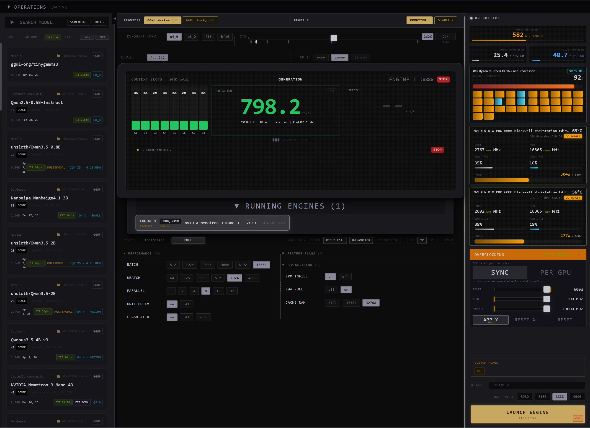

# Blackwell Ops

**The control room for a fleet of local models on Windows.**

Blackwell Ops is a Windows desktop app for running many GGUF models on your own
NVIDIA GPUs. Each engine gets its own process, config, port, and telemetry; the
app tells you whether a model will fit before you load it, launches llama.cpp
with the right flags, and shows prefill, decode, and slots while the fleet runs.

It is built for the part of local AI that a chat window does not cover: a
reasoner, a coder, a small fast model, and an embedder running side by side, long
context, speculative decoding, and a brain model or agent harness routing work
across their endpoints.

Native Windows. No WSL, no Docker, no Electron.

*Operations view on a 2× RTX PRO 6000 workstation: model library, measured fit,
26 parallel slots, live generation, and hardware monitor in one window.*

**Early build** · Windows 10/11 x64 · NVIDIA CUDA · GPL-3.0

*Independent project; not affiliated with NVIDIA.*

**[Download the latest release →](https://github.com/Seen-Tomorrow/blackwell-ops/releases/latest)**

## The problem

Local inference is easy to start and hard to operate.

The model loads, then you find out it did not fit. The agent feels slow, then
you find out prefill is the bottleneck. You change one flag, relaunch, and lose
the comparison you were trying to make. A chat app hides all of this; a terminal
shows it only if you know which line to read.

Running one model well is one problem. Running a reasoner, a coder, a small
router, and an embedder at the same time is another: which one fits, which one
is busy, which one is thrashing, and which one is worth the VRAM? A single-chat
tool cannot answer that, and a pile of terminals makes it worse.

Blackwell Ops makes the three decisions visible: **Fit. Launch. Watch.**

## Fit. Launch. Watch.

| Fit | Launch | Watch |
|---|---|---|
| Will this model, at this context, on this GPU split, actually fit? A FIT probe and learned VRAM points answer it. When nothing has been measured, the app shows a skeleton instead of a guess. | One place per engine for model, context, device, split, speculative decoding, and parallel slots. Save the configurations you repeat; skip the flag notebook. | Prefill vs decode, per engine and per slot, with context occupancy and speculative acceptance. The meter tells you which trade you actually bought. |

## The fleet pattern

A common setup: one brain model for planning and routing, a coder, a small fast
model for cheap calls, and an embedder for retrieval - each on its own engine,
each with its own context and flags. The harness sends work to the right
endpoint; the app keeps the whole fleet visible and alive.

Most local tools optimize a single model on a given topology. Blackwell Ops does
that per engine, then lets many engines coexist on the same workstation. The app
is the substrate: process ownership, fit, config, and telemetry. The
orchestration stays with your brain model or harness.

## Who it is for

Windows workstations with one or many NVIDIA GPUs: one, two, four, eight,
twelve, or a mixed set of cards. The app has no four-GPU ceiling; each engine
targets a specific GPU and split, so different cards are just different targets.
It is for people who run GGUF models as infrastructure: coding agents, several
specialists at once, long context, MTP/DFlash tuning, and local endpoints that
other tools depend on.

You already have the weights. You care whether 32k or 64k fits, whether a
two-GPU split is worth it, and what speculative decoding did to prefill. You
want to see the fleet, not just the answer.

## Who it is not for

- A chat window and nothing else. A chat app is the right tool.
- One command with a hidden daemon. A one-command runner is the right tool.
- A single-model setup. If one model on one box is all you need, a single-model
  runner is simpler.
- A team inference server. There is no multi-user auth, RAG, or audit layer.
- AMD, Intel, or Apple GPUs. The supported GPU path is NVIDIA CUDA on Windows.
- A promise of API or config stability. The direction is still being decided.

## What is in the current build

- **Fleet scale.** Up to 64 concurrent engines in the current build, each with
  its own port, config, and telemetry. The cap is a product limit, not a hardware
  limit; the app has no four-GPU ceiling and targets each engine at a specific
  GPU or split, including mixed cards.
- **Engine ops.** Launch, monitor, bench, and stop the fleet from one panel, or
  run parallel slots on one engine. Engines run in private Job Objects with
  PID-only teardown and port locks.
- **Measured fit.** FIT probe plus learned VRAM points for the model, context,
  and GPU split, with a visible skeleton when no measurement exists.
- **Live telemetry.** Per-engine and per-slot prefill/decode, context
  occupancy, and speculative acceptance, read from `/slots` plus engine stderr.
- **Tuning.** Provider templates, per-model overrides, a detailed llama.cpp
  parameter editor, and presets for configurations you repeat.
- **Build provenance.** Foundry builds `llama-server` in-app with the STABLE
  (CUDA 12.9) or FRONTIER (CUDA 13.x) toolchain pack.
- **Speculative decoding.** MTP and DFlash profiles where the model and engine
  build support them.
- **Models.** GGUF library scan and metadata, Hugging Face downloads, and
  draft-model pairing.
- **Portable.** Relative-path layout, no account, no telemetry. Network access
  is limited to explicit model/engine downloads and update checks.

## Current state

Early. The core loop - fit, launch, watch - works on Windows with NVIDIA CUDA,
and the current build has been stress-tested with 64 concurrent engines. The
surface is still narrowing; interfaces and config shapes may change, and nothing
here is a roadmap promise.

## Quick start

1. Install the app. The installer bundles the GGML master runtime; the portable
   layout works once an engine pack is present.
2. Point Setup at a folder of GGUF files.
3. Pick a provider profile, a model, and a context that fits.
4. Launch, then read the live prefill and decode meters.
5. Point any OpenAI-compatible client or agent at the engine's local port.

## Requirements

- Windows 10/11 x64.
- NVIDIA GPU with CUDA for GPU inference.
- GGUF weights (not included).
- Optional: the Foundry toolchain pack for source builds.

## Links

- **Releases:** https://github.com/Seen-Tomorrow/blackwell-ops/releases
- **Issues:** https://github.com/Seen-Tomorrow/blackwell-ops/issues
- **Third-party notices:** [THIRD_PARTY_NOTICES.md](THIRD_PARTY_NOTICES.md)
- **License:** GPL-3.0 ([LICENSE](LICENSE))
